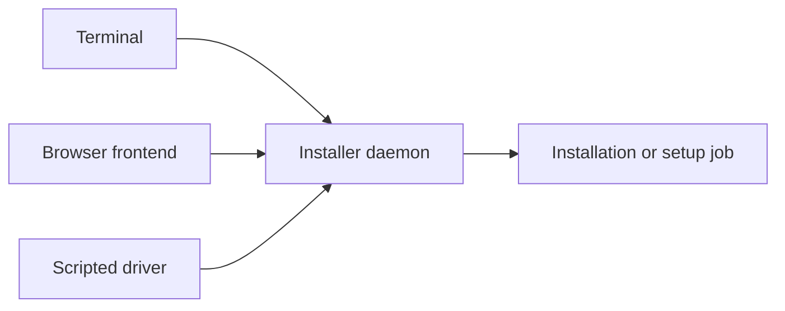

An installer daemon keeps one live conversation in memory. A frontend
connects to that conversation to show its current questions and progress.
The conversation belongs to the daemon rather than to a browser tab.

A second client can attach to the same live conversation. Its answers affect
the same state, so multiple clients are collaborators rather than isolated
sessions. Starting a client is not proof that it created a fresh operation.

## Disconnects and restarts

Closing a frontend does not stop an active job. A reconnect can show the
current turn while the daemon remains alive. Restarting the daemon loses
the conversation; the protocol does not make an interrupted disk operation
transactional or provide durable recovery.

Completed and failed conversations are cleared so a later start can create
another conversation. Read and preserve a failure result before retrying.
Starting again is an additional operation, not an automatic rollback.

## Progress and completion

A successful installation job reaches a result page that offers restart.
The restart request and the actual disk boot are separate events. A daemon
can accept a restart request without proving the firmware booted the target.

The graphical frontend retains a failed job's result until you request a
new conversation. Its log download records the job's output. `msip-drive`
prints a trace, but its abbreviated log display is not a complete audit
journal. See `msip-drive(1)` for automation constraints.

## Slow clients and completion

Each connection has one writer, so complete messages remain in order. The
server disconnects a client if its queued output exceeds 4 MiB, including
the frame being written, or if writes make no progress for 10 seconds. A
client that stops reading does not hold the conversation lock indefinitely.

At conversation completion, final messages drain outside that lock with a
shared 10-second deadline. A start request during retirement receives an
unavailable result. After retirement finishes, a fresh start can create the
next conversation. A disconnected client must not assume that its last
action failed or replay it without checking the daemon's state.
